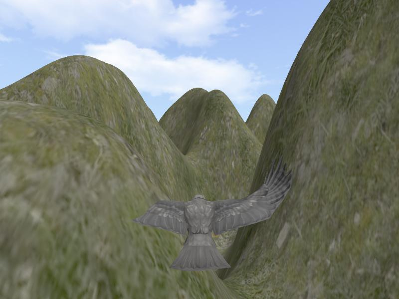

# terrain

Fly an eagle over procedurally generated hills. Built with [three.js](https://threejs.org/) and Vite.



- Terrain is a 500x500 plane displaced by Perlin noise (`ImprovedNoise`), with a tiled grass texture and a cube-map skybox.
- The eagle is an animated glTF model driven by `FlyControls` with auto-forward; the camera trails behind it.

## Run

```bash
npm install
npx vite
```

Then open http://localhost:5173. Mouse to steer, W/S to pitch, A/D to yaw, Q/E to roll.

## Credits

Eagle model: "White Eagle Animation Fast Fly" by [GremorySaiyan](https://sketchfab.com/GremorySaiyan), licensed under [CC-BY-4.0](http://creativecommons.org/licenses/by/4.0/).
